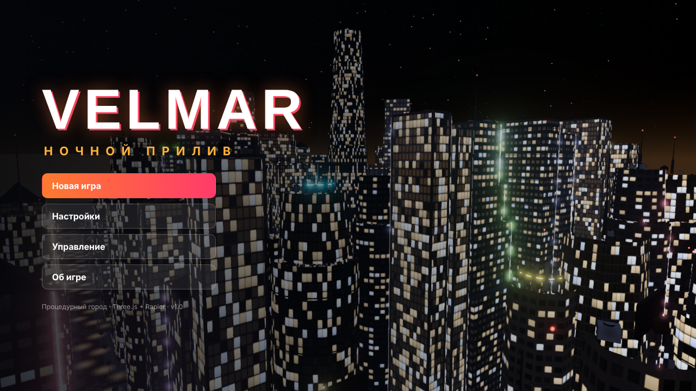
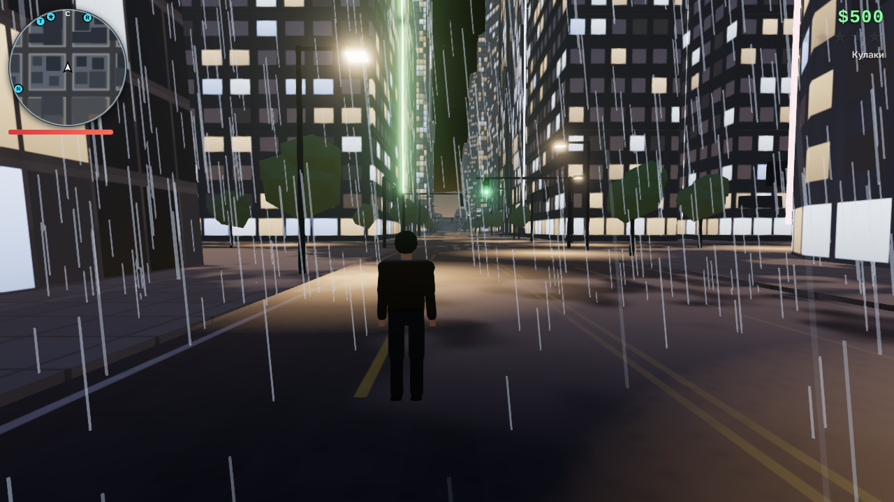
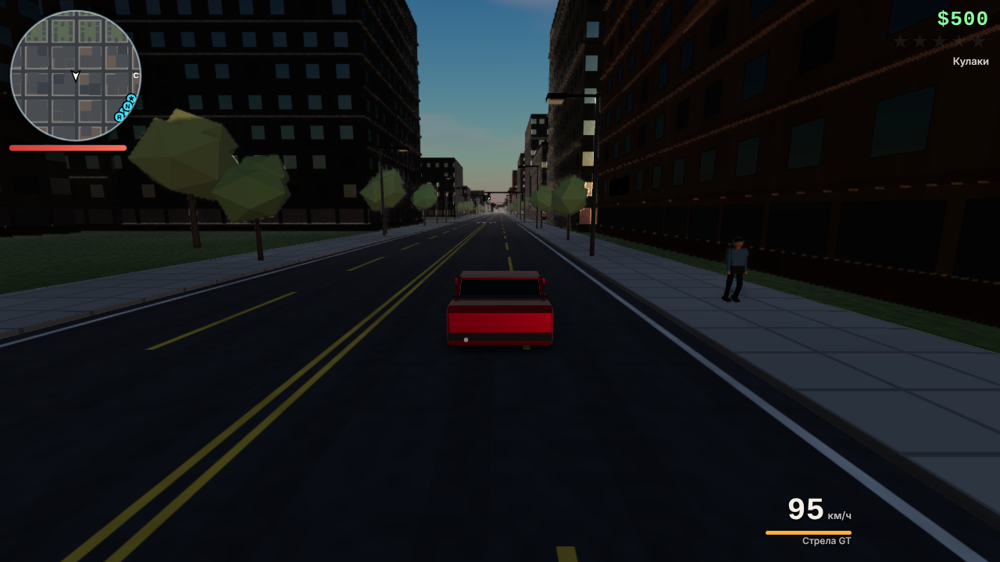
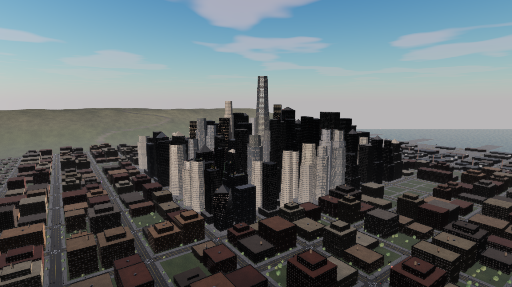
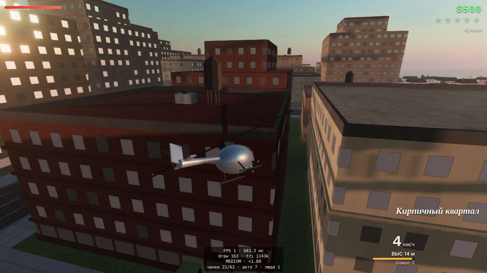
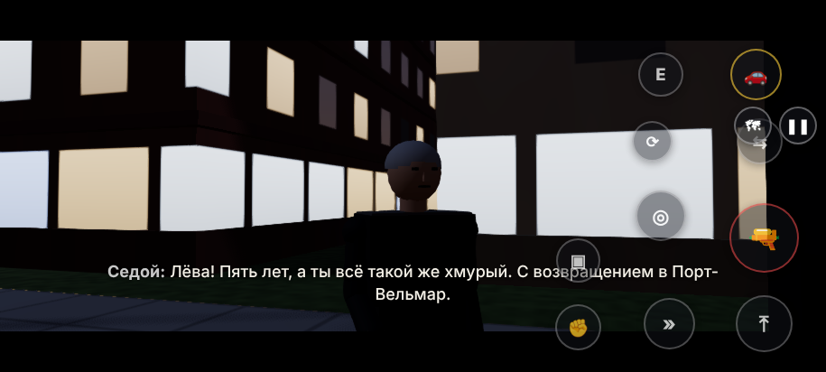
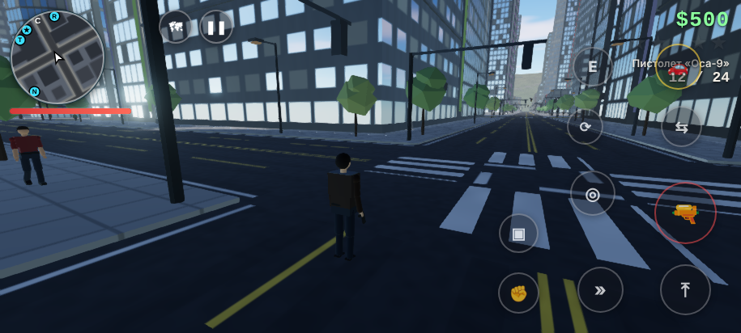

# VELMAR: Ночной прилив

Мобильная 3D open-world игра в жанре криминального экшена. Действие происходит в вымышленном портовом городе
**Порт-Вельмар**. Всё, что есть в игре (город, небоскрёбы, машины, вертолёт, лодка, персонажи, текстуры, неон, звук
и радио), генерируется кодом при запуске. Внешних ассетов нет.

Стек: **Three.js r187 (WebGL2) + TypeScript + Vite**, физика **Rapier (WASM)**, звук **WebAudio**,
упаковка в Android через **Capacitor 8**.



| | |
|---|---|
|  |  |
|  |  |
|  |  |

## Сюжет

Лев Корсак, водитель старой банды, выходит после пяти лет колонии: он взял на себя чужое ограбление.
Его встречает бывший босс Гена «Седой» Ломов, а механик Нина Варга даёт ему угол в мастерской.
Город подмял застройщик Аркадий Сабуров по прозвищу **Барон**: он хозяин порта и строит 300-метровый Шпиль.

1. **Возвращение.** Встреча на автовокзале, первая поездка (обучение вождению).
2. **Долги.** Выбить долг у Жоры Шныря, первая перестрелка.
3. **Ночной забег.** Уличная гонка через деловой центр против трёх соперников.
4. **Тихая гавань.** Стелс: сфотографировать груз Барона на Складе №7, уйти на катере.
5. **Бронированный.** Перехватить броневик, повредить его, угнать и уйти от полиции (2★).
6. **Двойное дно.** Засада на стройке. *Поворот:* Седой сдал Льва и пять лет назад, и сейчас.
7. **Крыса.** Погоня за Седым. *Поворот:* капитан Дробова восемь лет собирает дело против Барона.
8. **Шпиль.** Угнать вертолёт, долететь до крыши небоскрёба, перебить охрану, задержать Барона.

Побочные задания (голубые маркеры): такси «Вельмар-Экспресс», уличная гонка, ночной патруль на полицейской машине,
заказ Нины на угон конкретной модели, 20 тайников по городу.

## Что есть в игре

**Графика.** PBR (MeshStandard), динамическое солнце и луна с циклом дня и ночи, каскадные тени (CSM, мягкая PCF-фильтрация),
небо Preetham с облаками, карта окружения из неба (PMREM), ночная засветка города, звёзды,
экспоненциальный высотный туман с подсветкой со стороны солнца, GTAO (SSAO), Bloom, тональная компрессия ACES,
дождь с мокрыми поверхностями и лужами-зеркалами, молнии, неоновые вывески, светящиеся рёбра небоскрёбов,
авиационные огни, фары, стоп-сигналы, мигалки. Пресеты Low, Medium и High с авто-выбором по FPS
и динамическим разрешением.

**Мир.** Город 2×1,6 км и остров 3,2×3,2 км. Районы: деловой центр с небоскрёбами (6 типов силуэтов: уступы,
подиум с башней, цилиндр с короной, сужающийся восьмигранник, закрученная башня, башни-близнецы со скайбриджем),
Кирпичный квартал, Ржавый Пояс, порт с причалами, кранами и контейнерами, пригород с домиками,
шоссе по периметру, пляж с пальмами, холмы с серпантином и лесом. Есть парки, площадь с монументом и стройка.

**Геймплей.** Бег, прыжок, плавание, укрытия у стен, стрельба (4 вида оружия, автонаведение на тач-экране),
ближний бой, посадка в любой транспорт (с выкидыванием водителя). Транспорт: 8 моделей машин, мотоцикл, катер,
вертолёт. У машин физика подвески, ручник и занос, повреждения с вмятинами, дым, пожар и взрыв.
ИИ-пешеходы и трафик со светофорами. Полиция с розыском 1–5★: патрули, погоня по графу дорог,
пешие копы, арест, вертолёт на 4★, спецназ на 5★, поиск и сброс розыска.
Деньги, магазин оружия, мастерская (ремонт, тюнинг, покраска, гараж, сохранение), покраска с
сбросом розыска, больница. Миникарта, полноэкранная карта, GPS-маршрут по дорогам, метки.
Сохранения через Capacitor Preferences (в браузере это localStorage).

**Управление.** Виртуальный стик и контекстные кнопки на тач-экране, редактор раскладки
(перетаскивание, размер, прозрачность), клавиатура с мышью, геймпад (стандартная раскладка).

## Запуск

Нужен Node.js 20+ (проверено на 22).

```bash
npm install
npm run dev          # http://localhost:5173
```

С телефона в той же Wi-Fi сети откройте адрес вида `http://192.168.x.x:5173`: Vite выводит его в консоли.

Отладочные параметры адреса:

| Параметр | Что делает |
|---|---|
| `?play` | сразу в игру, без меню |
| `?mission=N&start` | начать сюжетную миссию N (0–7) |
| `?quality=low\|medium\|high` | принудительный пресет |
| `?time=22.5` | время суток |
| `?rain` | гроза |
| `?pos=x,z` | телепорт |
| `?stats` | FPS, draw calls, треугольники |
| `?touch` | показать сенсорные кнопки на десктопе |

## Сборка

```bash
npm run build          # проверка типов + сборка в dist/
npm run preview        # локальный сервер для dist/
npm run build:single   # один самодостаточный HTML в dist-single/
```

## Android (APK / AAB)

Проект `android/` уже сгенерирован (`npx cap add android`) и настроен: альбомная ориентация,
полноэкранный immersive-режим, экран не гаснет, иконка и заставка сгенерированы кодом (`tools/make-icons.py`).

Нужно на компьютере: **JDK 21**, **Android SDK** с platform 36 и build-tools 36 (проще всего поставить
Android Studio). Переменная `ANDROID_HOME` должна указывать на SDK (или файл `android/local.properties`
со строкой `sdk.dir=...`).

```bash
npm install
npm run build                 # веб-сборка в dist/
npx cap sync android          # копирует dist/ в android/ и обновляет плагины

cd android
./gradlew assembleDebug       # Windows: gradlew.bat assembleDebug
# → android/app/build/outputs/apk/debug/app-debug.apk

adb install -r app/build/outputs/apk/debug/app-debug.apk
```

Короче: `npm run android:debug` (то же самое одной командой).

Через Android Studio: `npx cap open android`, затем **Build → Build APK(s)** или **Run** на подключённом телефоне.

### Релиз для Google Play (AAB)

```bash
# 1. Ключ подписи (один раз; храните файл и пароли в надёжном месте)
keytool -genkey -v -keystore velmar-release.jks -keyalg RSA -keysize 2048 -validity 10000 -alias velmar

# 2. Подпись: в Android Studio — Build → Generate Signed Bundle / APK,
#    или добавьте signingConfigs.release в android/app/build.gradle.

# 3. Сборка
cd android && ./gradlew bundleRelease
# → android/app/build/outputs/bundle/release/app-release.aab
```

Минимальная версия Android: 7.0 (API 24). Нужен WebView с WebGL2: Chromium-WebView, Android 8+ на практике.

## Управление

**Клавиатура и мышь.** WASD: движение, газ/тормоз/руль. Мышь: камера. ЛКМ: огонь. ПКМ: прицел.
Shift: бег (в вертолёте вниз). Пробел: прыжок или ручник (в вертолёте вверх). C: укрытие. V: удар.
F: сесть или выйти. E: действие (магазины, миссии). R: перезарядка. 1–5, колесо, Tab: оружие.
H: сигнал. N: радио (3 генеративные станции). T: мигалка у полицейской машины. Q/E: рыскание вертолёта.
M: карта. Esc: пауза. Enter: пропустить реплику.

**Геймпад.** Левый стик: движение. Правый: камера. RT: огонь или газ. LT: прицел или тормоз. A: прыжок или ручник.
Y: сесть. B: удар. X: перезарядка. LB/RB: оружие. Start: пауза. Back: карта.

**Тач.** Левая половина экрана работает как плавающий стик, правая крутит камеру. Набор кнопок зависит от транспорта.
Раскладка настраивается в меню: Пауза → «Раскладка кнопок».

## Структура проекта

```
src/
  core/      Engine (рендер, пресеты), Quality (FrameGovernor), Physics (Rapier), Input, Audio, Events, MathUtil
  render/    Materials (патчи шейдеров: фасады, дороги, вода, кузова, туман), SkySystem (солнце, CSM, PMREM),
             PostFX, Weather, Particles, Decals, VehicleModels, NeonAtlas
  world/     CityLayout (районы, здания, места), RoadGraph (полосы, светофоры, A*), Terrain, ChunkBuilder, World (стриминг)
  entities/  CharacterModel (скелет, анимация), Character, Player, CameraRig, Vehicle, VehicleManager, Weapons
  ai/        Traffic, Pedestrians, Police, ShooterAI, DriverAI
  game/      Game (главный цикл), Missions (движок шагов), Story (8 миссий), SideJobs, Shops, Markers, Economy, Save
  ui/        HUD, Minimap (+ полноэкранная карта), TouchControls, UI (меню, настройки, магазины)
android/     Capacitor-проект
tools/       скриншоты (Playwright), автотесты миссий, бенчмарк, генератор иконок
```

## Тесты и замеры

При запущенном `npm run dev`:

```bash
node tools/mission-test.mjs   # проходит все 8 сюжетных миссий «читами» и ловит исключения
node tools/side-test.mjs      # то же для подработки
node tools/bench.mjs          # draw calls / треугольники / CPU по пресетам → shots/bench.json
node tools/shot.mjs "play&time=22&rain" shots/x.png   # скриншот
```

Результаты замеров и список оптимизаций лежат в [PERF.md](PERF.md).

## Ограничения

- Производительность на реальных телефонах не измерялась: в облачной среде сборки нет ни GPU, ни Android-устройства.
  Заложены динамическое разрешение и авто-понижение пресета. FPS и статистику видно в игре (Настройки → «Показывать FPS»).
- Персонажи низкополигональные, собраны из примитивов на скелете. Ragdoll-физики нет, падение анимировано процедурно.
- ИИ водителей простой: полосы, светофоры, дистанция, погоня по графу дорог. Пешие NPC обходят препятствия лучами, без навмеша.
- Вся геометрия города процедурная и «стилизованная»: стекло и окна считаются в шейдере, интерьеров нет.
